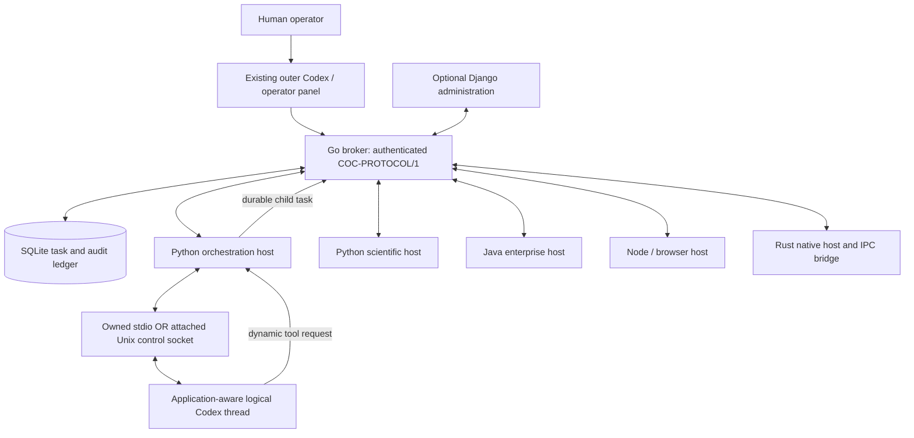
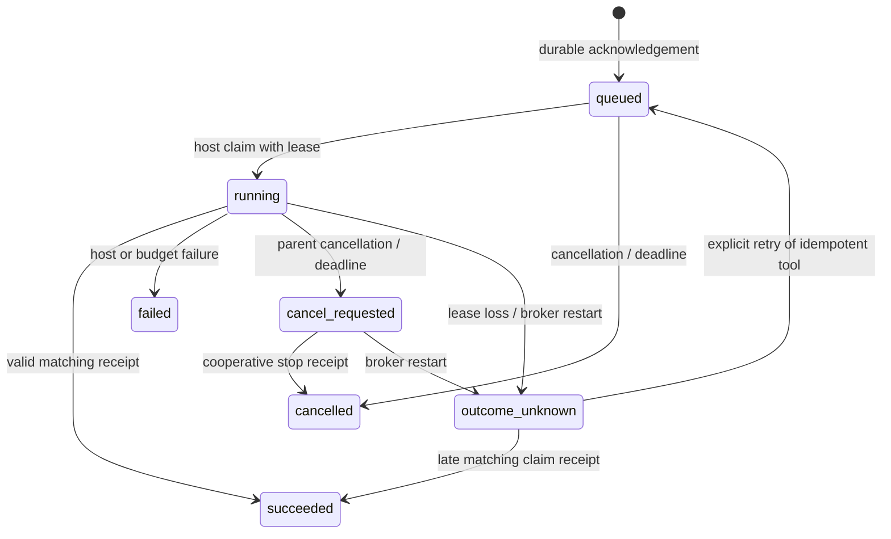

# Architecture

The broker is the coordination authority, not the AI inference process. It owns
authentication, delegation, leases, idempotency and durable receipts. Hosts poll
for claims and publish results. This avoids arbitrary callback URLs and keeps
application authority in the adapter. A native library, logical thread and
operating-system process are different entities.

One broker and one shared App Server can serve multiple logical agent contexts.
The tested orchestrator serializes turns on each connection. Concurrent provider
contexts require additional scoped connections/workers; COC does not yet claim
unrestricted concurrent turn multiplexing on one connector.

## Task state and ownership

Each task has an owner principal, host, parent/root, depth, deadline, attempt,
idempotency key and capability scope. Claims carry unpredictable attempt IDs.
Ancestors constrain authority and budgets. Equivalent ancestor operations,
excessive depth, duplicate active requests and oversized task trees are rejected.
Cancellation propagates to descendants but never pretends to undo committed work.

SQLite WAL and FULL synchronous commits protect acknowledged broker admission.
Task transitions and associated audit events commit together. A restart marks
in-flight work uncertain. Exactly-once arbitrary external effects are impossible
without host-side transactions/idempotency. The Java demonstration uses a task-ID
primary key for its database effect.

## Context and evidence

Protocol events distinguish messages, application errors, tool operations,
provider usage and lifecycle records. `ContextStore` adds a scoped local memory
interface with source, timestamp, kind, selected readers, integrity digest and
expiry. It runs inside a trusted orchestrator, not as a separate auth service.
Codex receives published tool schemas and selected prompts/results, not all memory.

Receipts identify the executor and input/output digests. The broker validates
contracts; semantic correctness is established separately by tests or host
read-back. Hash-linked audit records also bind task snapshots. They detect
accidental/tampered records under the tested threat model; they are not signed
attestations against an administrator able to rewrite the entire database.

## Limits of this milestone

This is a single-machine broker. Several scheduler queries still scan retained
task history; large-scale pagination, indexed scheduling, global admission caps,
high availability and archival rotation require further work. Host leases and
per-tree concurrency are implemented, not a cluster scheduler. Resource metrics
measure the broker process; GPU accounting and per-provider remote resources are
unavailable. High-assurance clinical/financial production use is not approved by
this implementation or its synthetic demonstrations.
