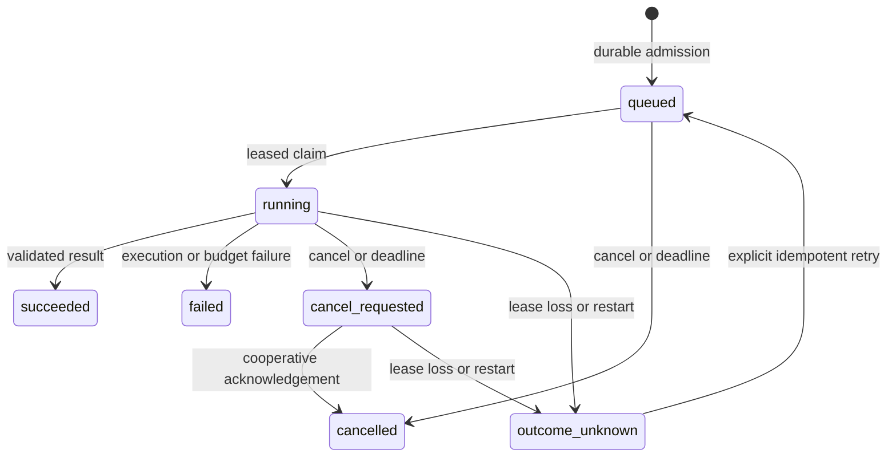

# COC-PROTOCOL/1 — implemented contract

Status: versioned engineering alpha. The executable envelope is
[`message.schema.json`](../schemas/message.schema.json), JSON Schema Draft 7.
`scripts/generate-contracts.mjs` generates Python and TypeScript copies. The Go
broker remains the authorization and application-schema authority.

## Transport and identity

`POST /rpc` carries one JSON-RPC 2.0 request and response. Batches and notifications
are not supported on this transport. The body limit is 1 MiB. Credentials travel
only in `Authorization: Bearer ...`, never in envelopes, tool arguments or URLs.
HTTP is allowed only on loopback; remote connections require TLS. Clients reject
redirects. Browser integrations use the broker origin or a same-origin gateway;
the broker does not enable unrestricted CORS.

All defined envelope properties are required. Nullable routing identifiers may be
null. `agent_id` must match the authenticated principal. Metadata `scope` grants
no authority; persisted token scopes control authorization. Request status is
`request`. Envelope timestamps use RFC 3339, within ten minutes past and one
minute future. Persisted task/event/expiry timestamps use **Unix milliseconds**;
API `ttl_seconds` and `timeout_seconds` use seconds.

JSON-RPC `id` correlates the response. Response `correlation_id` identifies the
request's `message_id`. Durable tasks separately preserve `id`, `parent_id`,
`root_id`, `owner`, host, tool and attempt. An envelope ID is not an idempotency
key. Session records map logical COC contexts to authorized Codex thread IDs;
they do not imply process ownership.

Success data is at `result.payload.data` inside a JSON-RPC result envelope.
Errors use JSON-RPC `error.code`, `message`, and optional `data.type`. HTTP
401/403 may precede protocol processing. Stable categories include `SCOPE_DENIED`,
`NOT_FOUND`, `CONFLICT`, `SCHEMA_INVALID`, `BUDGET_EXCEEDED`, `DEPTH_EXCEEDED`,
and `CYCLE_DETECTED`.

## Methods

| Method | Payload / effect | Authority |
|---|---|---|
| `COC.HELLO` | Version and supported operations | Authenticated identity |
| `COC.AUTHENTICATE` | Issue principal/scopes/TTL, revoke, or issue panel ticket | `auth:issue`, attenuation, ownership |
| `COC.DISCOVER` | Visible hosts; `view:system` for snapshot | `discover` or `system:read` |
| `COC.CAPABILITIES` | Visible tools and schemas | `discover`, filtered tool scopes |
| `COC.REGISTER` | Host/agent identity and capabilities | `host:register` / `agent:register`, ownership |
| `COC.ATTACH` | Session ID, host, optional Codex thread ID | `session:attach`, ownership |
| `COC.TOOL_REQUEST` | Host, tool, arguments, idempotency key, budget/deadline | Exact `tool:<host>:<tool>` |
| `COC.DELEGATE` | Same plus parent task ID | Tool scope, `task:delegate`, parent authority/limits |
| `COC.TOOL_RESULT` | Task/claim IDs, outcome, result/error, usage | Host owner, current attempt, output schema |
| `COC.RECOVER` | Task status; `action:claim` leases; `action:retry` reconciles | Visibility, ownership, retry policy |
| `COC.CANCEL` | Task ID; propagates to descendants | Owner or authorized administrator |
| `COC.HEARTBEAT` | Host ID; renew leases, receive cancellation IDs | Host owner |
| `COC.MESSAGE` | Persist structured message | `event:write`; no implied model invocation |
| `COC.EVENT` | Application/operator-assistance event | `event:write` |
| `COC.ERROR` | Sanitized diagnostic event | `event:write` |
| `COC.DETACH` | Host or session ID | Ownership; does not kill external Codex |
| `COC.SHUTDOWN` | Graceful broker shutdown | `system:shutdown` |

Capabilities publish version, description, input/output schemas, idempotency and
cancellation support. The broker disables external schema references. Idempotency
is a host obligation, not a guarantee about arbitrary remote side effects. Host
and tool names are application-selected; the broker has no demo-specific routing.

## Durable lifecycle

SQLite WAL with synchronous FULL persists acknowledged admission and transitions.
Repeated owner/idempotency-key submissions return the same task; changed arguments
conflict. Equivalent outstanding tasks and ancestor cycles are rejected. Retries
preserve ID, increment attempt and invalidate stale claims. The initial policy
allows at most three attempts for explicitly idempotent tools before the deadline.
A lost HTTP response requires reconciliation, not blind resubmission.

Default tree limits: depth 2, 16 tasks, concurrency 4, 8192 tokens. These are
configurable within admission bounds. Parent authority and deadlines constrain
children. Reported remote token usage is cooperative accounting, not a hard
billing ceiling. Root admission is not a global multi-tenant quota.

Receipts bind task, executor, host, tool, attempt, input/output digests and outcome.
An append-only SHA-256 event chain binds task snapshots. Startup verifies it.
Hashes use Go JSON serialization, not a cross-language canonicalization standard.
A privileged database administrator could rewrite an unsigned chain. Host claims
about external effects need independent verification; code modification alone is
not proof of repair.

## Events and adapters

`GET /events?after=<sequence>` streams persisted SSE events to `system:read`
principals. Clients resume and deduplicate by sequence; the broker rechecks token
validity during streaming. This is administrator-wide visibility, not per-tenant
filtering. TypeScript reconnects with bounded backoff; Python/Java expose streams
whose callers manage reconnection. Exited host processes require an owner restart.

Rust forwards bounded NDJSON stdio requests to the authenticated broker. MCP stdio
implements 2025-06-18 tools only: `tools/call` returns durable admission/task ID;
completion is obtained through COC. No sampling or HTTP MCP is advertised.
gRPC, Protobuf, A2A and remote WebSocket transports are not implemented.

Breaking envelope/authority changes require a new protocol version. Additive host
tools are independently versioned. Database migrations are numbered and
transactional; back up a stopped broker before upgrading.
